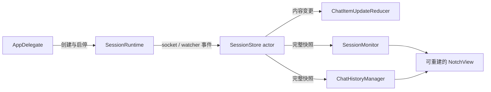

# Nook 架构治理方案（2026-10-22）

## 判断与范围

值得做结构性治理，但当前不宜把整个应用改写为多 package，也不应仅按文件长度拆文件。已有 `SessionEvent → SessionStore → ChatItemUpdateReducer → UI` 主干、provider adapter 和确定性测试可以保留；优先补齐资源所有权与生命周期边界，让后续拆分有可靠的验证基础。

本轮在 `feature/architecture-governance` 实施一期。用户已确认历史回填决策、问答/权限手测等旧待办暂不处理；不改变 provider 协议、权限策略、窗口布局公式或历史持久化产品行为。

以下判断来自源码与现有测试的静态审查，描述结构性风险，不代表已通过真实 agent 会话复现线上故障。

## 现状与优先级

| 优先级 | 证据 | 影响 | 决策 |
| --- | --- | --- | --- |
| P1 | `NotchView.onAppear` 启动 `SessionMonitor`；`WindowManager` 换屏会重建视图；monitor 同时负责订阅、socket 路由、interrupt watcher 和周期检查 | 进程级服务的所有权依附窗口，难以独立验证启停；socket 自身已有重复启动保护，不能据此声称重复 bind | 一期：进程级 session runtime 归 AppDelegate，monitor 保留 UI 投影与用户操作 |
| P1 | `SessionStore` 多个退出分支分别删除 session、同步 task、registration 和 provider 元数据；排序信息保存在全局 item ID 字典 | 新退出路径容易漏清理；不同会话的相同 item ID 共享排序元数据 | 一期：统一会话资源释放入口，排序元数据按会话归属，补生命周期回归 |
| P1 | `ChatHistoryManager.updateFromSessions` 在旧字典上累加；`loadedSessions` 也累加 | UI 派生缓存没有遵守完整快照的删除语义 | 一期：以 store 快照重建投影并清理已移除会话 |
| P1 | `AppDelegate` 测试启动也可能安装 hooks、创建窗口、启动 socket 与遥测；现有 CI 仅在 release tag 运行 | 自动化验证与真实运行环境耦合；合并前缺少回归反馈 | 一期：隔离测试宿主启动副作用，加入 PR/main 的 Debug 测试检查 |
| P2 | `SessionStore` 同时承担多个 provider 状态机、I/O 调度、进程匹配和发布 | actor 内职责集中，后续 provider 变更容易扩大审查面 | 后续：按 provider 抽纯状态 reducer，并把 I/O 作为显式 effect；每迁移一个 provider 保持端到端 fixture 测试 |
| P2 | OpenCode/Cursor 生命周期与 chat item 入口各自创建异步 Task，早到事件 buffer 无明确容量策略 | 跨入口顺序与未知会话缓存寿命的契约尚不完整 | 后续：先定义顺序、缓冲和丢弃策略，再统一 ingress；保留 PRIMARY/DEFENSIVE 双路径 |
| P2 | Claude 文件同步在 `await parse` 前持有 session 快照，返回后继续提交；取消检查不覆盖全部 await 边界 | 移除、重建同 ID 会话或 reset 与在途读取相交时，旧结果仍可能回写 | 下一期优先：为读取引入 session generation，使用可挂起的假 parser 验证旧结果拒绝与当前状态合并 |
| P2 | Xcode 27.1 构建仍报告现有模型/adapter 的 MainActor 隔离诊断，项目使用 Swift 5 language mode | 部分告警在 Swift 6 mode 会成为错误 | 后续：先为纯值模型与纯计算明确隔离，再分模块启用严格并发检查；本期修正新 runtime 的隔离诊断 |
| P3 | 旧 `FileSyncScheduler` 与 store 内调度并存；部分 Core/UI 与 service 使用 singleton | 有未完成的抽象和隐式依赖 | 后续：围绕真实调用边界逐步注入依赖，删除证明无调用的抽象；不增加通用框架 |

## 一期设计

### 应用拥有 session runtime

- `AppDelegate` 创建并持有唯一 runtime，在启动完成时启动、退出时停止。
- Runtime 负责 hook/socket ingress、provider 事件路由、interrupt watcher delegate 与周期状态检查。
- `SessionMonitor` 仅订阅 store 的 UI 投影并提供现有用户操作接口；窗口重建不会启动或停止 runtime。
- 保持现有事件映射、Codex 串行队列、permission 清理逻辑和 provider adapter 行为。
- 启停必须幂等，周期检查的异步启动/停止按调用顺序执行，不能留下迟到的 start。
- `stop()` 关闭 ingress 并释放 watcher，不清空 store，也不等待已经派发的 provider Task 全部完成。当前应用只在退出时调用 stop；通用热重启/事件排空不是本期契约。Watcher 任务在异步返回后检查 generation，避免停止新一代 watcher。

### 会话资源具有明确归属

- 统一会话移除 helper，覆盖显式结束、provider 结束、进程退出、idle 过期、provisional 替换等路径。
- 区分需要保留的 Codex 迟到事件 tombstone 与应释放的 session 数据；不能把停止（idle）与移除（ended）混为一谈。
- 排序元数据按 session 隔离，在会话重置或移除时释放；只清理目标会话，不影响其他会话。
- 测试重置清理完整状态并取消后台任务，确保测试间不存在 registration、buffer、port/version 残留。
- 上述清理覆盖 store 当前持有的资源和任务句柄；原有 Claude parser 在途结果的代际失效尚未解决，不能把这次清理等同于全部异步 I/O 的事务隔离。
- `ChatHistoryManager` 是 store 的派生投影；缺席于完整快照的会话不继续保留 history、description 或 loaded 标记。
- 注册前缓冲同时保存事件原有的 lifecycle policy；历史批次回放保持 content-only，实时批次保持既有生命周期效果。

### 验证成为合并前的反馈

- 测试宿主跳过真实应用 bootstrap，避免依赖本机 hooks、窗口、socket、遥测和单实例检查。
- 保留非并行测试宿主，直到所有 singleton 与 parser 测试都具备隔离条件。
- GitHub Actions 对 PR 和 main 执行 app 单元测试及现有 packaging 单元测试，失败保留诊断产物。
- 不因新增 CI 改动 release 发布流程或仓库分支保护；检查是否设为必需由仓库维护者后续配置。

## 验收与回滚

1. 新增确定性测试覆盖 runtime 幂等启停/顺序、会话资源清理/跨会话隔离、UI 快照移除语义、测试宿主识别。
2. 全量 `NookTests` 通过，现有 packaging 单元测试通过，Release 编译通过。
3. 检查 diff，确认没有 provider wire-format、权限策略、picker 高度和历史恢复行为修改。
4. 如环境允许，执行 Debug 启动 smoke check；真实 agent 权限/问答与物理换屏不作为自动测试已经覆盖的声明。
5. 分层提交，必要时分别回滚 runtime、state、CI 变更；没有数据格式迁移。

## 后续治理准则

- 新进程级服务由应用生命周期拥有，SwiftUI view 不负责启动全局监听服务。
- 新会话资源必须说明创建、重置、释放路径，并接入统一清理。
- 新 provider 先实现 adapter/reducer fixture 契约，再接入 ingress；不在 UI 中解释 wire events。
- 状态归属和依赖单向性比文件行数更重要；只有实际边界需要时才引入 protocol 或 package。
- UI 仍遵守 [SwiftUI/macOS lessons](swiftui-macos-lessons.md)；跨进程变更仍按 AGENTS.md 读取相应兼容性 spec。

## 实施证据

- AppDelegate 持有 `SessionRuntime`；窗口重建只创建新的 `SessionMonitor` 投影。测试启动在任何真实 bootstrap 之前退出。
- `HookSocketServer` 的 start/stop 在同一串行队列执行，取消 handler 仅关闭其所属 listener fd；测试使用独立临时 socket。
- `SessionStore` 的所有直接 session removal 收口到一个 helper；排序字典按 session 隔离；OpenCode fallback probe 使用可取消 task/token，阻止旧 probe 覆盖 reset 或新握手。
- 新增 22 项测试：runtime 4、测试宿主 4、socket 2、store 生命周期 9、聊天投影 3。最终完整 Debug 回归为 208/208；现有 packaging 测试为 16/16。Xcode 27.1 下 Release 通用构建（arm64 + x86_64）和 strict codesign 验证通过。
- Debug 实际启动 smoke check 通过：使用启动参数临时关闭自动 hook 安装，确认进程、`/tmp/nook.sock` 和原生 Codex 事件接收；应用运行期间额外执行测试宿主 4/4 通过，原 listener 仍属于同一应用 PID。正常退出后进程/socket 均已释放。此次使用已有构建产物直接启动，以传入现有 Run 脚本不支持的临时参数。
- 本地证据（构建产物不提交）：`build/architecture-governance-verified-tests.log`、`build/ArchitectureGovernance-VerifiedTests.xcresult`、`build/architecture-governance-release.log`、`build/architecture-governance-coexistence.log`。CI YAML 已通过语法解析。
- 尚未验证：真实 provider 权限/问答 e2e、物理换屏、远端 GitHub Actions 运行。旧待办保持原样。
