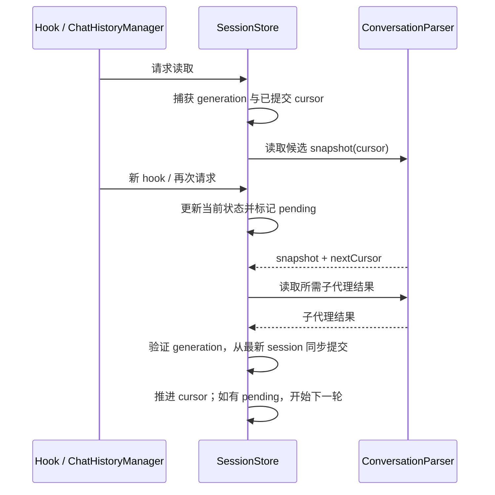

# Claude 文件读取生命周期治理（二期，2026-10-22）

## 决策与范围

本期承接 [架构治理一期](2026-10-22-architecture-governance.md)，在 `feature/architecture-governance` 上治理 Claude 文件读取的资源归属、异步结果失效和提交边界。用户已授权执行本期；历史回填决策、问答/权限快捷键手测等旧待办继续保留，不纳入本期。

下述风险来自源码与调用链的静态审查，并非已通过真实 agent 会话复现的现场故障。目标是让删除、同 ID 重建、reset 和显式 clear 与在途读取相交时具有可验证的行为，同时保留读取期间到达的新 hook 状态。

本期不改变历史产品恢复策略：读取哪些历史、何时展示历史、历史内容的转换以及 `/clear` 的既有展示规则保持原有语义。不增加持久化格式、历史恢复入口或跨 provider 协议；OpenCode/Cursor ingress 顺序、权限策略及 UI 布局不在本期范围。

## 静态风险与入口审计

| 位置 | 当前风险 | 本期处理 |
| --- | --- | --- |
| `SessionStore.scheduleFileSync` | 新 hook 取消旧任务，但 parser 可能已推进共享增量游标；丢弃旧结果后，下一次只读新增行可能遗漏尚未提交的内容 | Store 拥有游标；每会话 single-flight，新请求仅排下一轮 |
| `SessionStore.processFileUpdate` | 在 `await parse` 前取出 session，返回后把旧 struct 写回；移除后可能复活，或覆盖读取期间的新 hook 状态 | 先收集候选读取结果，最后从最新 session 同步提交 |
| 子代理文件读取 | `inout SessionState` 与工具数组索引跨越 await；旧工具状态及列表可能覆盖当前状态 | 读取阶段只收集结果，提交时按当前工具 ID 合并 |
| `loadHistoryFromFile` | 完整历史、完成工具集合、结果与 metadata 分别读取，旧结果缺少读取开始时的会话身份 | history/full sync 共用受控入口，generation 贯穿整个读取 |
| `ChatHistoryManager.syncFromFile` | 在 store 之外读取后发送裸结果，若接收时才取 generation，会把旧结果认作新会话结果 | Manager 只向 store 发起请求，不直接调用 parser |
| Parser 的共享 `incrementalState` | 仅按 session ID 保存 offset/messages；失效结果仍可能改变后续读取依据 | 新生产读取 API 使用调用方传入的 opaque cursor，返回候选 nextCursor |

审计时 `AgentFileWatcher` 没有外部启动调用，`AgentFileWatcherBridge` 对应的 `agentFileUpdated` 在 store 中为 no-op；旧 `FileSyncScheduler` 也没有生产调用点。本期不启用或重构这些闲置入口。未来若接入它们，读取必须经过本方案的受控入口，不能直接提交无 generation 的结果。

## 所有权与读取契约

### Store 拥有会话代次与游标

每个 Claude 会话的读取状态归 `SessionStore` 所有：

- generation：标识本次会话读取生命周期；在第一次异步读取之前取得。
- `ClaudeConversationCursor`：opaque 值，store 保存和传递，parser 解释其内部状态。
- 当前 single-flight task 和下一轮 pending flags：合并增量、history 与 full-sync 请求。

generation 必须在删除后同 ID 重建、reset 后同 ID 重建时与旧值不同。不能因清空计数器而重用旧值。生命周期失效同时解除旧 task/cursor 的所有权；旧任务即使仍在执行，也不能提交数据、推进游标或清除新一代任务句柄。

普通新 hook 不使当前读取失效，也不取消它，只标记下一轮读取。这样既不丢弃已经读取的内容，也能在当前轮完成后继续消费新追加的数据。不同会话互不阻塞、互不失效。

### Parser 生成候选结果

新读取 API 接收会话来源和 store 当前持有的 cursor，返回完整候选 snapshot 与 nextCursor。snapshot 包含本轮提交需要的消息、工具完成集合、工具结果、结构化结果、metadata 和 clear 信息。

Parser 对传入 cursor 进行值语义处理，不提前修改 store 的 cursor，也不读写共享 legacy cursor。候选结果只有经 store 验证并成功提交后，其 nextCursor 才成为下一轮读取的依据。丢弃结果时，游标一并丢弃。

Cursor 只能用于它所属的文件来源；同 ID 重建不会继承旧会话 cursor。对不同 cwd/path 的读取不能共享 offset 或 messages。保留给其他调用方的 legacy API 不得成为本条生产链路的隐式状态来源。

Metadata 与其余主会话读取在同一个 parser actor 操作中收集，避免在多个 getter 之间拼接不同调用轮次的数据。这仅约束应用内部的读取组织：文件可能被 Claude 持续追加，主会话文件与子代理文件也分别读取，不能宣称是文件系统级的事务快照。后续读取继续负责收敛新增内容。

### 请求共用入口

自动文件同步、聊天首次 history load 与显式 full sync 共用 store 的请求入口。完整读取需求不能被随后到达的增量请求降级；已有读取进行中时，pending flags 保留下一轮所需模式。

`ChatHistoryManager` 继续负责 UI 投影与现有加载接口，但把读取委托给 store。删除裸 `fileUpdated` / `historyLoaded` 结果事件，避免结果接收方在旧读取已经完成后才取得当前 generation。调用方等待所属 single-flight task（含合并的后续轮次）完成；失效任务在 reader 返回后退出，不持有 Store 自己管理的等待 continuation。底层 reader 不响应取消时，调用方仍需等它返回，但它已无权提交。

## 失效与提交边界

### 哪些操作使读取失效

| 操作 | 读取生命周期行为 |
| --- | --- |
| 新 hook、普通同步请求 | 保留 generation，更新当前会话，合并下一轮请求 |
| session end / 统一会话移除 | 使旧 generation 失效，释放该会话读取状态 |
| `resetForTesting` | 所有旧 generation 失效；之后重建不得与旧值匹配 |
| 显式 clear | 使此前读取失效，保留既有 clear 重协调语义 |
| 同 ID 新会话 | 使用新 generation 与初始 cursor |
| 候选 snapshot 内检测到 `/clear` | 作为本轮有效候选的一部分提交其重协调结果，不让这轮结果因自我失效而丢失 |

Cancellation 是减少无用工作的手段，generation 验证才是拒绝旧结果的依据。Parser 或文件 I/O 不立即响应取消时，正确性仍须成立。

### 一次提交不跨越 await

主会话 snapshot、现有 MainActor adapter 转换和所需子代理结果收集完成后，store 先验证 generation、session 存在且 provider/source 仍匹配，再从当前 `sessions[sessionId]` 取值。后续内容合并、工具完成处理、session 写回、游标推进和本轮发布组成同步提交段，期间不再 await。

提交不能把读取前持有的完整 session 覆盖回来。读取期间新增的 hook 工具、phase、activity 和其他仍有效状态必须保留。子代理结果按当前工具 ID 合并；工具已被删除或不再对应候选任务时跳过，不能依赖旧数组索引，也不能把旧 parent tool 的 status/result 整体写回。

纯 history load 保持 content-only：若发现 clear，只保留 `needsClearReconciliation` 标记，由下一次 sync 执行重协调。Sync 重协调除了保留有效内容，还用读取开始时的 tool/task startTime 基线保留期间新到的 hook tracking；Claude 不创建 hook placeholder，不能以缺少可见条目为由删除这些新追踪。保留既有两秒内容宽限规则。

Cursor 只在内容提交成功时推进。失效分支不得写入 chatItems、排序信息、description、clear 标记、工具完成状态或 nextCursor。旧轮次退出时也只能清理自己拥有的任务状态。

## 验收要求

确定性并发测试使用可挂起的假 reader 控制完成顺序，不依赖 sleep 碰概率，不连接真实 agent、不读取用户历史目录。Parser 的游标测试使用独立临时文件。

| 测试场景 | 通过条件 |
| --- | --- |
| 受控读取挂起后结束会话，再返回结果 | 会话不复活，相关资源与副作用不恢复 |
| history load 挂起后同 ID 重建；manager full sync 走注入入口 | 旧结果拒绝，新代读取正常完成；所有入口共享生命周期校验 |
| 读取挂起后 reset，再同 ID 重建 | 旧 generation 不可匹配，旧完成回调不清理新 task |
| Metadata 读取挂起期间收到新 hook | 新 phase、工具、activity 等不会被旧 session 快照覆盖 |
| 子代理读取挂起期间 parent 工具完成/新条目加入，或会话结束并重建 | 按当前 ID 合并，保留当前 parent 状态，不复活旧会话内容 |
| A 读取进行中，文件追加 B 并收到新 hook | 下一轮被合并调度，最终 A+B 均提交，无增量丢失 |
| 丢弃候选结果后用原 cursor 重读 | 未提交的数据仍可读到；nextCursor 未提前生效 |
| 同 ID 不同 cwd/root 的 parser 读取 | 不继承其他来源的 cursor 或 legacy 缓存 |
| 删除会话 A 时会话 B 正在读取 | B 正常提交，验证代次按会话隔离 |
| 显式 clear 与在途完整读取交错 | 旧结果不能穿过 clear；随后读取遵守既有重协调规则 |
| 正常增量、history、full sync、工具完成、子代理、文件内 `/clear` | 保留现有内容与状态语义，完整读取请求不被增量请求吞掉 |

完成上述针对性测试后运行全量 `NookTests`，并完成 Release 编译。检查最终 diff，确认生产 Claude 读取没有绕过受控入口、没有新增共享 legacy cursor 写入、没有更改 provider wire format、权限策略或历史产品恢复策略。真实权限/问答 e2e 与旧手测待办不作为本期自动测试已经覆盖的声明。

## 回滚与实施证据

本期没有数据格式迁移。回滚应保持 store 入口、parser cursor 契约、manager 委托和事件删除相互匹配，不能只回滚其中一层而留下可绕过代次的裸结果入口。

- 已在 `feature/architecture-governance` 实施：统一 Store 读取入口、候选 cursor/snapshot、代际检查、同步提交、manager 委托及裸结果事件移除。Parser 保留 legacy API 兼容；生产 Store/Manager 不再调用这些共享 cursor API。
- 新增 23 项确定性回归：`ClaudeConversationReaderTests` 7 项、`SessionStoreClaudeReadTests` 16 项。首轮定向 17/17，补齐审查指出的交错时序后，最终完整 Debug 测试为 **231/231**，无失败。
- Xcode 27.1 下 Release 构建成功，产物包含 **arm64 + x86_64**，`codesign --verify --deep --strict` 通过。
- 两次独立源码审查后，补齐了无 placeholder 的新 hook tracking 保留、纯 history clear 的副作用隔离、旧 task 不清理新 flight，以及子代理 await 后同 ID 重建的验证。
- 本地证据（构建产物不提交）：`build/claude-read-verified-tests.log`、`build/ClaudeReadGovernance-Verified.xcresult`、`build/claude-read-release.log`。
- 既有模型、DebugLog 等 Swift 6 隔离告警仍存在；本期没有切换 Swift language mode。未进行真实 Claude 权限/问答 e2e 或远端 CI 验证；这些不计入自动化通过声明。旧待办保持不变。
